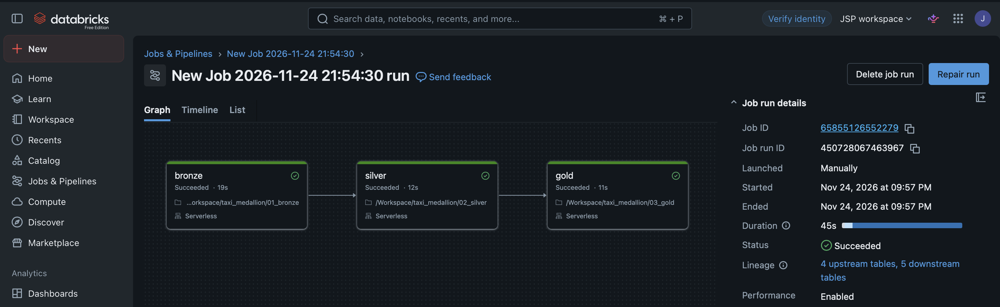

# NYC Taxi Medallion Pipeline (Databricks Free Edition)

A small hands-on project to learn and demonstrate the medallion (Bronze → Silver → Gold)
lakehouse pattern, built with PySpark, SQL and Delta Lake on Databricks Free Edition,
using the built-in `samples.nyctaxi.trips` dataset and orchestrated with a 3-task Databricks Job.

## Pipeline run

## Architecture
- **Bronze:** raw trips copied from `samples.nyctaxi.trips` + ingestion metadata
- **Silver:** validated, deduplicated (hash key), typed. Invalid rows go to a quarantine table (0.39% of rows rejected)
- **Gold:** daily revenue by pickup zip, hourly demand

## Data quality rules
fare > 0, distance > 0, dropoff after pickup, zips not null (null-safe using `coalesce`)

## Delta Lake features explored
MERGE, DESCRIBE HISTORY, time travel, RESTORE, schema enforcement, OPTIMIZE

## Notebooks
1. [01_bronze](notebooks/01_bronze.ipynb): ingest raw data into a Delta table
2. [02_silver](notebooks/02_silver.ipynb): validation, quarantine, deduplication, derived columns
3. [03_gold](notebooks/03_gold.ipynb): business-level aggregates
4. [04_delta_demo](notebooks/04_delta_demo.ipynb): MERGE, time travel, schema enforcement, RESTORE, OPTIMIZE and % of quarantined rows

## Tech stack
Databricks Free Edition (serverless), PySpark, Spark SQL, Delta Lake, Unity Catalog, Databricks Jobs

## What I learned
It's very interesting how you can ingest raw data (even from a built-in dataset), clean it
up in a Silver phase, and then build a Gold layer for analysis. Concepts like quarantining
rows, the NULL trap, and using `coalesce` are key to avoiding losing data without noticing it and that's something I initially didn't understand: why a comparison with NULL doesn't return false, and seeing rows fall through a filter made it click.
